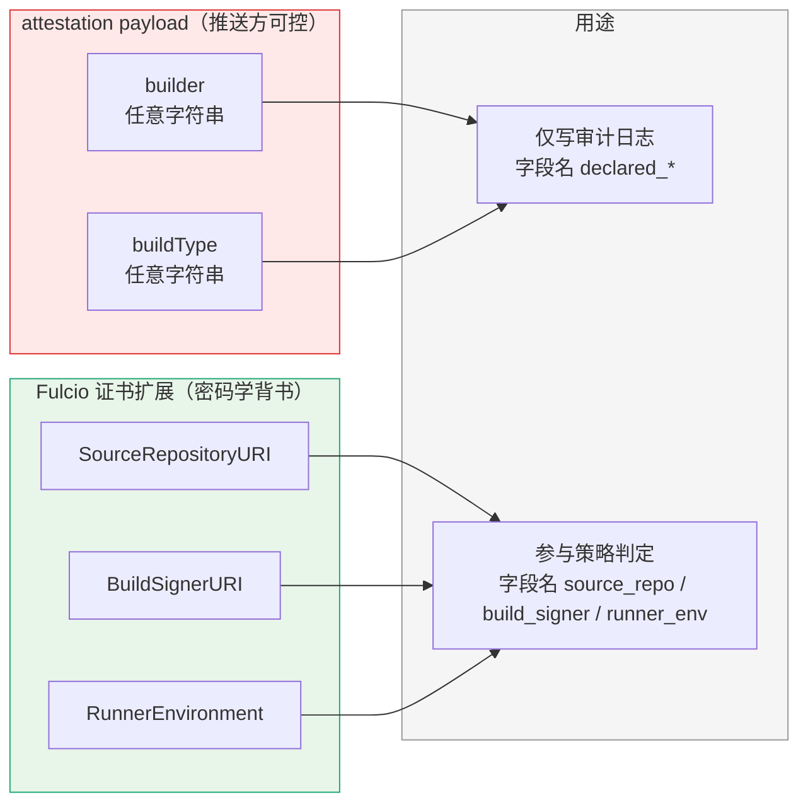
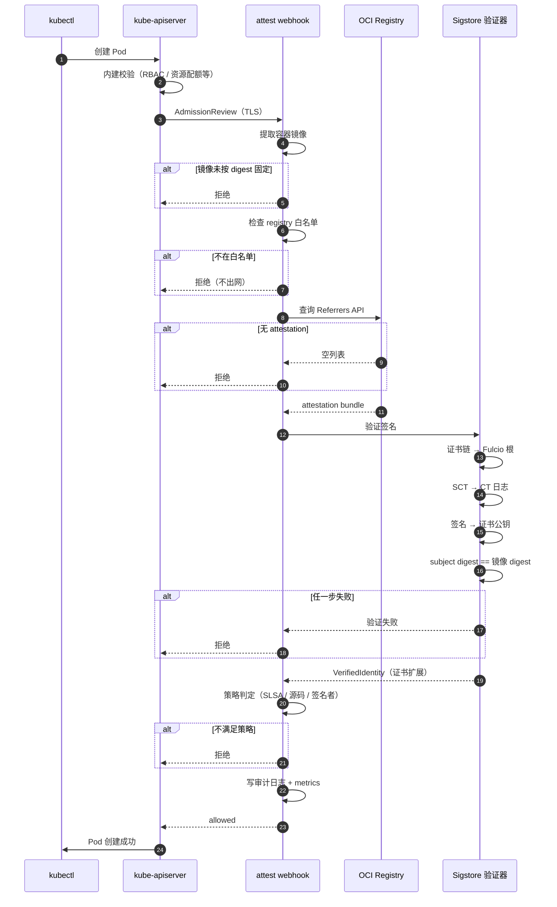
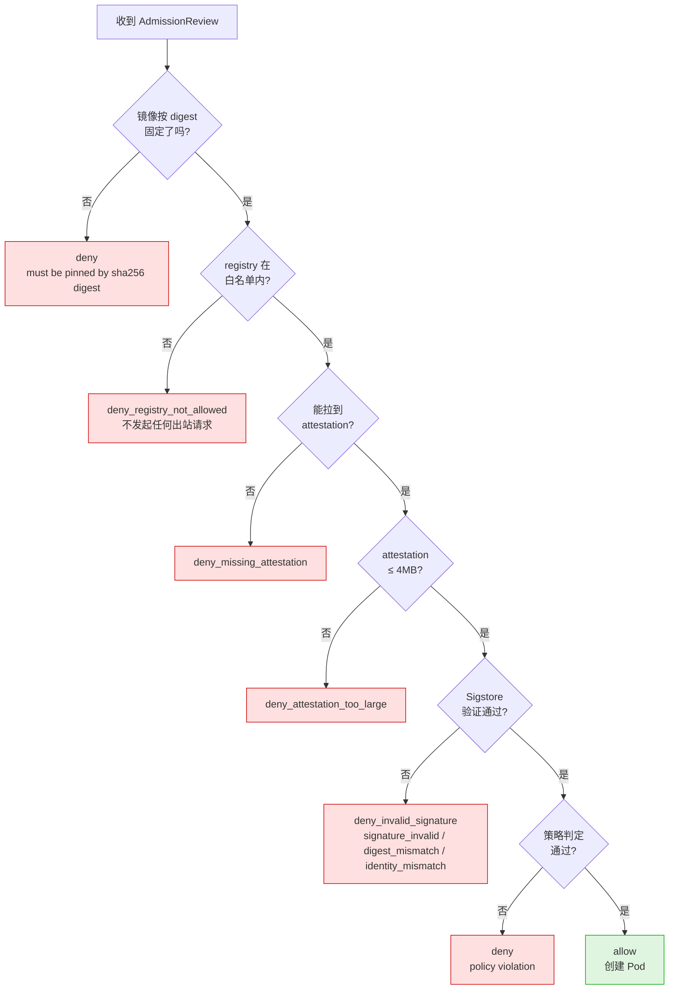
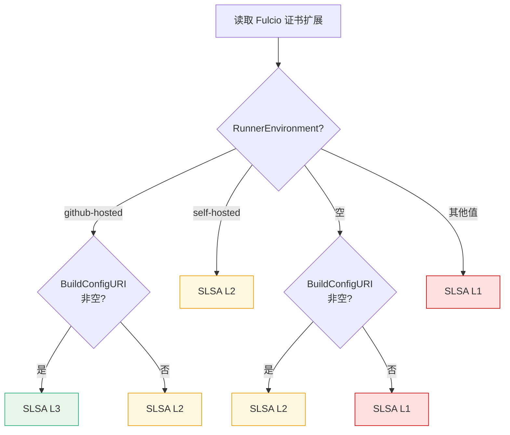
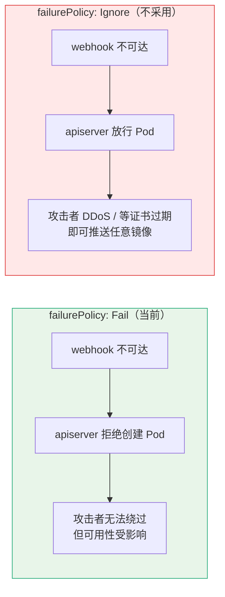
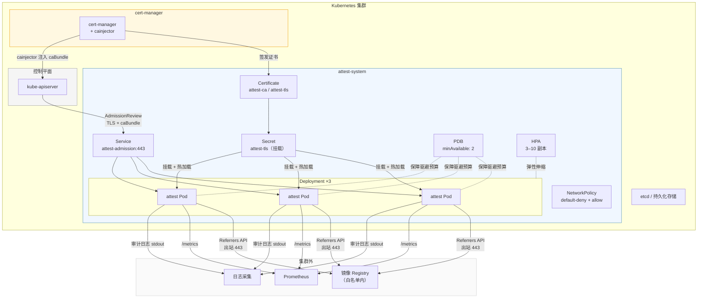
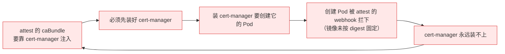
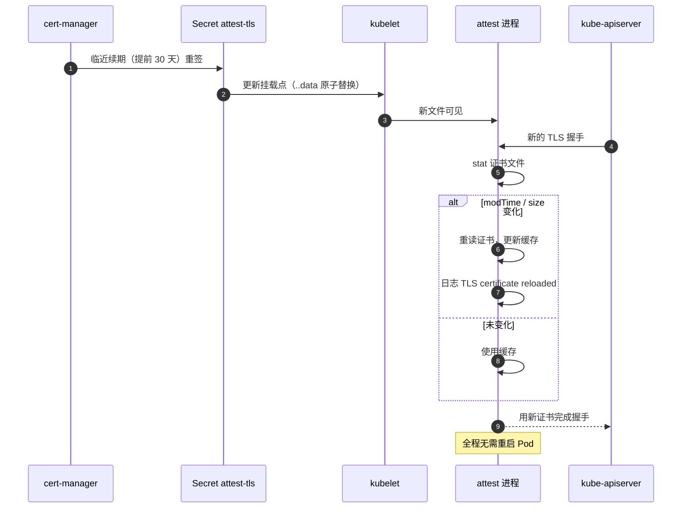
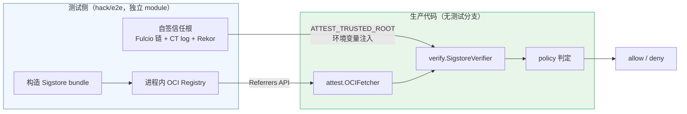

# attest

**Kubernetes 准入阶段的镜像来源证明验证器。**

在 Pod 被创建之前，验证镜像的 Sigstore 签名、SLSA provenance 与构建身份，
按声明式策略决定是否放行。**任何一项验证失败一律拒绝**——没有"验证不了就先放过"这个选项。

[](https://github.com/wyh-code26/attest/actions/workflows/ci.yml)


---

## 为什么需要它

镜像签名只证明"有人签了它"，不证明"它由可信的构建系统、从可信的源码构建而来"。

攻击者拿到一张有签名的镜像，照样可以把恶意镜像推上去——**签名验证通过，但它不是你要的镜像**。
只检查"有没有签名"这条路，在真实攻击面前几乎没有防护力。

attest 把判定依据从"谁签的"推进到"在什么环境、用什么代码、被谁构建的"：

- 校验证书链、SCT、Rekor 透明日志收录（Sigstore 完整验证链）
- 从 **Fulcio 证书扩展**读取构建身份，而不是读 attestation payload
- 按策略判定 SLSA 等级、源码仓库、构建签名者
- 判定失败 → 拒绝 Pod 创建

### 关键设计：只信证书，不信 payload

attestation 的 payload 里有一个 `builder` 字段，写着"我是由 xxx 构建的"。
这个字段是推送方自己填的字符串，**谁都能写成 `https://github.com/google/...`**。

真正经过密码学背书的只有 Fulcio 证书里的扩展字段。所以 attest 的判定逻辑
全部基于证书扩展：



payload 里的 `builder` / `buildType` 只写进审计日志，**不参与判定**。
日志里同时记录"证书说是什么"和"payload 自称是什么"，不一致时可作为攻击信号。

---

## 快速开始

### 前置条件

- Kubernetes ≥ 1.25（保守声明：所依赖的 API 均在更早版本 GA，
  声明 1.25 是为避开 1.22–1.24 的废弃 API 迁移窗口）
- [cert-manager](https://cert-manager.io/) ≥ 1.16（证书签发与 caBundle 注入）
- Helm 3

```bash
helm repo add jetstack https://charts.jetstack.io
helm install cert-manager jetstack/cert-manager \
  -n cert-manager --create-namespace \
  --set crds.enabled=true
```

> 国内网络若拉不到 `charts.jetstack.io`，可换用镜像源，或先在有网环境
> `helm pull` 后离线安装。也可以直接用 `hack/kind-setup.sh`，
> 它已在 Kind 场景下处理了 cert-manager 安装与失败重试。

### 部署

```bash
helm upgrade --install attest chart/ -n attest-system --create-namespace
kubectl rollout status deploy/attest -n attest-system --timeout=180s
```

### 验证它真的在工作

```bash
# 应当被拒绝：镜像没按 digest 固定
kubectl run probe --image=nginx:latest --restart=Never
# Error from server: admission webhook "attest.wyh-code26.github.io" denied the request:
#   image "nginx:latest" must be pinned by sha256 digest

# 应当通过：镜像合规、有可信 provenance
kubectl run ok --image=ghcr.io/your-org/app@sha256:<digest> --restart=Never
```

### 配置策略

策略是声明式文件，改它不需要重新编译：

策略与身份 allowlist 的**唯一生效来源是 `chart/values.yaml` 的
`config.policy` 与 `config.identities`**（渲染成 ConfigMap 后覆盖镜像内文件）。
没有第二个需要同步的策略文件。

```yaml
# chart/values.yaml -> config.policy
min_slsa_level: 3

allowed_source_repositories:
  - "https://github.com/your-org/your-repo"

allowed_build_signer_regex:
  - '^https://github\.com/your-org/your-repo/\.github/workflows/release\.ya?ml@refs/tags/v[0-9]+\.[0-9]+\.[0-9]+$'
```

```bash
helm upgrade attest chart/ -n attest-system --reuse-values
```

Chart 用 `checksum/config` 注解把配置哈希写进 Pod 模板，改配置一定触发滚动重启。

---

## 工作原理



**每一步失败都直接拒绝，不降级、不跳过、不 fail-open。**

### 判定顺序



### 拒绝原因分类

`metrics` 与审计日志里用固定分类，便于告警区分"镜像有问题"和"基础设施有问题"：

| 分类 | 含义 |
| --- | --- |
| `deny_invalid_image` | 镜像引用非法，或未按 digest 固定 |
| `deny_missing_attestation` | 镜像没有 attestation |
| `deny_registry_not_allowed` | registry 不在白名单（策略拒绝，非拉取失败） |
| `deny_attestation_too_large` | attestation 超过 4 MB 上限 |
| `deny_invalid_signature` | 签名/证书链/SCT 验证失败 |
| `deny_invalid_signature`（`digest_mismatch`） | 签名合法但 subject digest 与镜像不符 |
| `deny_invalid_signature`（`identity_mismatch`） | 证书身份不满足策略 |
| `deny_policy` | 签名有效但不满足策略 |
| `deny_fetch_error` | 网络/registry 故障 |

另有 `deny_no_object`、`error_bad_request`、`error_method_not_allowed`
等请求层分类，用于区分"镜像有问题"和"请求本身不合法"。

`deny_registry_not_allowed` 单独分类是有意的：若混进 `deny_fetch_error`，
运维会把它当成 registry 短暂抖动，而它其实是有人在尝试让本服务访问内网地址。

---

## SLSA 等级判定

`internal/verify/identity.go` 从证书扩展推导等级：



**为什么 self-hosted 封顶 L2**：L3 要求构建过程由平台强制执行、构建方无法篡改。
自托管 runner 的运行环境由构建方自己控制，即使提供了构建配置，也无法证明它被强制执行。

---

## 安全不变量

这几条在设计上不可配置，不提供 values 开关：

| 不变量 | 说明 |
| --- | --- |
| `failurePolicy: Fail` | 验证失败必须拒绝。降级放行意味着攻击者只要让 webhook 不可达就能绕过准入 |
| `timeoutSeconds: 10` | 不提供调大选项。调大只会掩盖真实故障，并拖慢全集群 Pod 创建 |
| 镜像内无私钥 | 证书由 cert-manager 签发，Secret 挂载。构建期用 `find` 扫描，发现任何 `.key`/`.crt` 直接失败 |
| caBundle 恒为空 | 由 cainjector 通过 `cert-manager.io/inject-ca-from` 注入。清单里硬编码 caBundle 是"忘了同步"故障的来源 |
| registry 白名单 | 空值启动时打 WARN。不配置等于允许任意镜像 host 触发本服务出站请求（SSRF） |

### 为什么 `failurePolicy` 不能改



**准入控制的价值等于它不可被绕过的程度**，所以可用性问题必须在运维层解决
（多副本 + PDB + 证书轮换监控），而不是在策略层让步。

代价是真实的：attest 故障会导致全集群无法创建 Pod。这个代价在
`docs/runbook.md` 里给了完整的紧急恢复流程。

---

## 生产部署形态



资源清单：

| 资源 | 作用 |
| --- | --- |
| `Deployment`（默认 3 副本） | 软反亲和分散到不同节点 |
| `PodDisruptionBudget` | `minAvailable: 2`，节点维护时保留处理准入的能力 |
| `HorizontalPodAutoscaler` | 3–10 副本，CPU 70% 触发 |
| `NetworkPolicy` ×2 | `default-deny` + 显式放行（入站 8090 / DNS / 出站 443） |
| `Certificate` ×2 | 自签 CA + webhook leaf，自动续期（1 年期，提前 30 天） |
| `Role` | 仅 `get` 指定的 Secret，不能 list/watch |
| `ServiceAccount` | `automountServiceAccountToken: false` |

其他特性：

- **证书热加载**：进程在每次 TLS 握手前检查证书文件，变化即重载。
  续期后**无需重启 Pod**。重读失败时保留旧证书，避免半写入窗口让握手全挂。
- **bootstrap 命名空间排除**：`attest-system` / `cert-manager` / `kube-system` /
  `kube-node-lease` 不受本 webhook 检查。

### 为什么必须排除 cert-manager 命名空间

这是一个实测踩到的死锁，不排除则集群永远装不起来：



这个闭环不是靠调策略能解开的——**cert-manager 的镜像确实没有按 digest 固定**，
按规则就该拒绝，放宽规则等于为了让基础设施能装而削弱准入。

解法只能是引导阶段排除。代价是这些命名空间不受检查，因此**不应在其中部署业务负载**。

### 证书轮换与热加载



**为什么不用 fsnotify 监听文件**：Secret 挂载更新走的是 `..data` 符号链接原子替换，
监听具体文件会因 inode 变化而失效。`stat` 的开销远小于一次 TLS 握手。

**为什么重读失败要保留旧证书**：cert-manager 写 Secret 与 kubelet 同步挂载点之间
存在窗口，此时文件可能短暂处于半写入状态。让所有握手瞬间失败是不可接受的。

### 本地开发（Kind）

```bash
make kind-setup   # 建集群 + 修 kube-proxy RBAC + 装 cert-manager + Helm 部署
```

Kind 某些版本的 kube-proxy SA 缺少 `system:node-proxier` 绑定，导致所有
ClusterIP 访问超时、webhook 报 `context deadline exceeded`。脚本会修复并自检。

---

## 可观测性

### 审计日志

每次决策一行 JSON 到 stdout：

```json
{
  "time": "2026-11-26T08:45:33Z",
  "request_id": "...",
  "namespace": "default",
  "name": "my-app",
  "image": "ghcr.io/org/app@sha256:...",
  "allowed": false,
  "reason": "signature_invalid",
  "message": "no valid provenance: ...",
  "slsa_level": 0,
  "source_repo": "https://github.com/org/repo",
  "build_signer": "https://github.com/org/repo/.github/workflows/release.yml@refs/tags/v1.2.3",
  "runner_env": "github-hosted",
  "declared_builder": "https://github.com/google/cloud-build",
  "declared_build_type": "..."
}
```

`source_repo` / `build_signer` / `runner_env` / `slsa_level` 来自**证书扩展**，是事实。
`declared_*` 是 payload 自述，攻击者可控。两者不一致（例如证书说构建自你的仓库，
payload 却说构建自别的平台）是明确的攻击信号。

审计结构体里**刻意没有 `builder` 字段**——证书给的是 workflow 签名者，
叫 `build_signer` 才准确；若同时存在 `builder` 与 `declared_builder`，
审计时极易把自述值当成事实。

> 日志只写 stdout，Pod 重建即丢失。生产必须接入日志采集系统。

### Prometheus

`/metrics` 暴露 `attest_admission_requests_total{result="..."}`，按拒绝原因分类：

```
# HELP attest_admission_requests_total Total admission review decisions, labeled by result.
# TYPE attest_admission_requests_total counter
attest_admission_requests_total{result="allow"} 42
attest_admission_requests_total{result="deny_no_object"} 0
attest_admission_requests_total{result="deny_invalid_image"} 0
attest_admission_requests_total{result="deny_missing_attestation"} 3
attest_admission_requests_total{result="deny_invalid_signature"} 1
attest_admission_requests_total{result="deny_registry_not_allowed"} 0
attest_admission_requests_total{result="deny_attestation_too_large"} 0
attest_admission_requests_total{result="deny_fetch_error"} 0
attest_admission_requests_total{result="deny_policy"} 0
attest_admission_requests_total{result="error_bad_request"} 0
attest_admission_requests_total{result="error_method_not_allowed"} 0
attest_admission_requests_total{result="error_internal"} 0
```

所有分类**恒定输出**（未出现的值为 0），不是只输出发生过的分类。
这样 Prometheus 端计数序列始终存在，`rate()` 与告警规则不必处理序列缺失。
`error_internal` 当前无代码路径产生，会恒为 0。

告警建议：`deny_registry_not_allowed` 突然上升意味着有人在内网扫描；
`deny_fetch_error` 上升是 registry 或网络故障，不是镜像有问题。

---

## 验收状态

项目有离线端到端验收套件，一条命令跑完：

```bash
make e2e
```



测试链路**完全离线**：自签一套与生产同格式的信任根，签发 Sigstore bundle，
推入进程内 OCI registry，再交给**生产代码**验签。生产代码里没有任何
"测试模式"分支，测试信任根只通过文件/环境变量注入。

| 用例 | 状态 |
| --- | --- |
| A1 合法 attestation 放行 | 通过（自签信任根）。**生产需用真实 Sigstore 根在真实 Registry 上复验** |
| A2 缺失 attestation 拒绝 | 通过（Kind 实测 + 自动化） |
| A3 篡改 payload 拒绝 | 通过（改一字节 → `signature invalid`） |
| A3 digest 不匹配拒绝 | 通过（签名合法但 subject digest 不符） |

生产部署形态在 Kind + cert-manager v1.16.5 上实测：

| 项 | 结果 |
| --- | --- |
| caBundle 自动注入 | 非空，`openssl verify` → OK |
| `failurePolicy` / `timeoutSeconds` | `Fail` / `10`，无开关可改 |
| PDB / NetworkPolicy | 均生效 |
| HPA | 成功收敛到 `minReplicas`；**Kind 无 metrics-server，`TARGETS` 显示 `<unknown>`，真实扩缩容能力未验证** |
| 证书自动重建 | 删除 Secret 后 30s 内 `READY=True` |
| 证书热加载 | 重签后 Pod 内证书已更新，`status.startTime` 未变 |

**已知限制**：

- HPA 的真实扩缩容能力未在生产指标环境验证
- A1 用自签信任根验证，真实 Sigstore 根与真实 Registry 的组合未覆盖
- 审计日志未内置采集/持久化，需接入现有日志栈

---

## 项目结构

```
cmd/api/                入口：HTTP server + 证书热加载
internal/
  attest/               镜像引用解析、OCI Referrers 拉取、payload 解析
  verify/               Sigstore 验证、证书扩展 → VerifiedIdentity
  policy/               声明式策略加载与判定
  httpapi/              AdmissionReview 处理、健康检查、中间件
  audit/                结构化审计记录
  metrics/              Prometheus 指标
  config/               环境变量配置
chart/                  Helm Chart（含 policy.yaml / identities.yaml）
hack/
  kind-setup.sh         本地环境一键搭建
  e2e/                  离线端到端验收套件（独立 module）
docs/runbook.md         运维手册：故障诊断树、证书轮换、紧急恢复
```

## 常用命令

```bash
make build      # 编译二进制到 bin/
make ci         # fmt + vet + test -race -cover
make e2e        # 离线端到端验收
make kind-setup # Kind 本地环境
```

## 文档

- `docs/runbook.md` —— 运维手册。webhook 故障诊断树、证书轮换、
  紧急降级流程、HPA/PDB 联动陷阱、常见误操作
- `chart/values.yaml` 的 `config.policy` —— 策略配置，字段级注释
- `chart/values.yaml` —— Chart 全部可调项

## License

[MIT](LICENSE)
