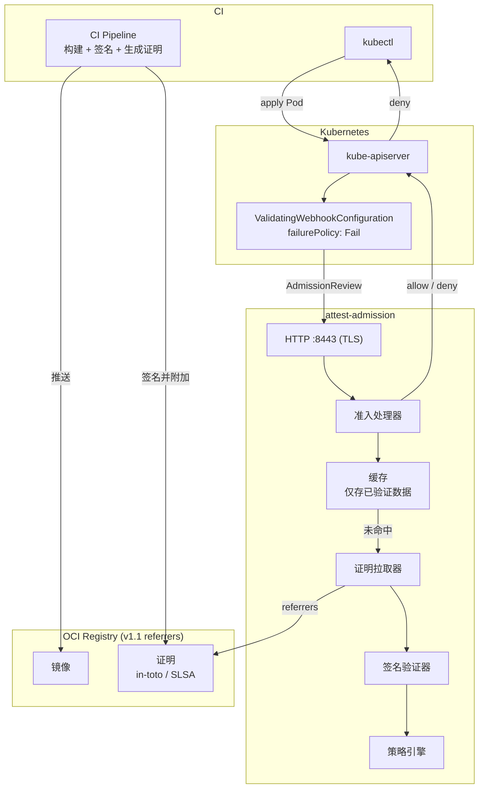
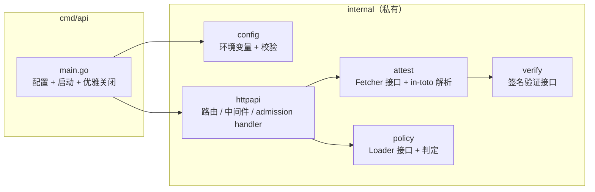

# attest

**在 Kubernetes 准入阶段强制执行 SLSA provenance。默认 fail closed。**

> **状态：阶段一（骨架已完成，验证逻辑未接入）**
>
> 目前 `/admission` 端点会解析 `AdmissionReview` 协议，但**始终返回 allow**。证明拉取、签名验证、策略判定尚未实现（阶段二至三）。
>
> **现在这个项目还不能真正拦截任何东西。** 请勿用于生产。

## 为什么做这个

软件供应链工具链已经解决了**生成证明**的问题：Sigstore 签名，in-toto 定义格式，SLSA 定义等级。缺的是在**部署时强制执行**它。

现有准入策略引擎（Kyverno、OPA Gatekeeper）擅长签名校验和静态字段匹配，但缺少原生、可扩展的方式来验证**语义化断言**：这个镜像是否达到 SLSA Level 3？构建者是否在可信白名单内？源仓库是否匹配？

另外，`ValidatingWebhookConfiguration.failurePolicy` 默认是 `Ignore`——Webhook 挂掉时请求直接放行。任何依赖这个默认值的策略，在故障瞬间等于不存在。

attest 填补的正是这个缺口：一个聚焦、可审计、默认 fail closed 的 Kubernetes 准入语义化证明验证器。

## 不可协商的标准

以下五条定义了这个项目。任何实现变更不得违反。

1. 验证发生在 **Kubernetes 准入阶段**，不是事后审计，不是 CI 软检查。
2. 证明缺失、拉取失败、签名无效、格式非法、策略不满足——**全部返回 deny**。不得退化为 warning 或放行。
3. 验证的是**语义化断言**（SLSA 等级、构建者身份、源仓库），不只是"有没有签名"。
4. 策略以**声明式配置**表达。改策略不需要改代码。
5. `ValidatingWebhookConfiguration.failurePolicy` 必须为 **`Fail`**。

**第 5 条的权衡**：Webhook 不可用时，新 Pod 无法部署。这是有意的——安全策略失效时放行，等于没有策略。代价是 Webhook 必须高可用：最低 3 副本 + HPA、PodDisruptionBudget、liveness/readiness 探针。完整运维要求见 runbook（阶段五）。

## 架构



图中 `CACHE`、`FETCH`、`VER`、`POL` 为阶段二至三的目标形态；阶段一只有 `HTTP` 与 `ADM`（且 `ADM` 恒返回 allow）。

### 包结构与依赖方向



关键约束：**依赖单向**；`policy` 不依赖 `attest`（策略判定可脱离 registry 单测）；`verify` 独立于 `attest`；所有依赖通过各包的 `*Deps` 结构体显式注入，无全局可变状态。

## 快速开始

**前置要求**：Go 1.26+、Docker、kind、kubectl。

```bash
git clone git@github.com:wyh-code26/attest.git
cd attest

# 生成自签证书（阶段一 1.3）
./hack/gen-certs.sh

# 编译并运行
make run

# 验证
curl -k -s https://localhost:8090/healthz
# {"status":"ok"}

curl -k -s https://localhost:8090/readyz
# {"status":"ready"}
```

向 `/admission` 发送一个构造的 `AdmissionReview`：

```bash
curl -k -s -X POST https://localhost:8090/admission \
  -H 'Content-Type: application/json' \
  -d '{"apiVersion":"admission.k8s.io/v1","kind":"AdmissionReview","request":{"uid":"t1","kind":{"kind":"Pod"},"operation":"CREATE","object":{}}}'
# {"apiVersion":"admission.k8s.io/v1","kind":"AdmissionReview","response":{"uid":"t1","allowed":true}}
```

Kubernetes 集群部署说明在阶段五提供。

## 路线图

| 阶段 | 范围 | 状态 |
|---|---|---|
| 1 | 骨架、路由、AdmissionReview 解析、TLS、kind 端到端、CI 最小集 | 进行中 |
| 2 | 证明拉取（OCI referrers）、in-toto/SLSA 解析、签名验证 | 计划中 |
| 3 | 策略引擎、声明式加载、完整 fail closed 路径 | 计划中 |
| 4 | 表驱动测试扩展、指标、审计日志 | 计划中 |
| 5 | Helm chart、cert-manager、PDB、HPA、NetworkPolicy、RBAC | 计划中 |

## 设计决策

- **AdmissionReview 用自定义 struct**，不引入 `k8s.io/api`。项目的价值在于理解准入协议本身；为一个极小的字段子集拉入整棵 k8s 依赖树会掩盖这一点。支持 `object`/`raw` 双字段回退。
- **缓存只存已验证的证明**，不存原始字节。接口包含 `Invalidate(digest)` 和可配置 TTL，防止证明撤销后旧数据继续生效。
- **策略加载器是接口**，阶段一至三用文件加载 + mtime 轮询（标准库），CRD/ConfigMap 后置。不使用 `fsnotify`。
- **API Key 不套用在 `/admission` 上**。调用方是 kube-apiserver，认证靠 TLS，不是共享密钥。CORS 在阶段一删除——准入没有浏览器调用方。
- **无全局可变状态**。所有依赖通过各包的 `*Deps` 结构体显式注入。结构体命名规则：`消费者名 + Deps`（`RouterDeps`、未来的 `VerifierDeps`），不建全局 `Deps` 惯例。
- **`HandlerTimeout` 是请求 deadline 的唯一真源**。handler 内直接 `ctx := r.Context()`，不得嵌套 `WithTimeout`，否则配置会静默失真。
- **不引入任何第三方依赖**（阶段一）。阶段二引入 OCI/签名生态时，每个新依赖必须记录选型理由与依赖树大小。

## 开发

```bash
make ci      # gofmt + go vet + go test -race
make build   # 编译到 bin/attest-api
make run     # 编译并运行
make test    # 仅跑测试
```

CI（GitHub Actions）在每次 push 与 PR 时运行 `gofmt`、`go vet`、`go test -race`。

## 许可证

MIT。
