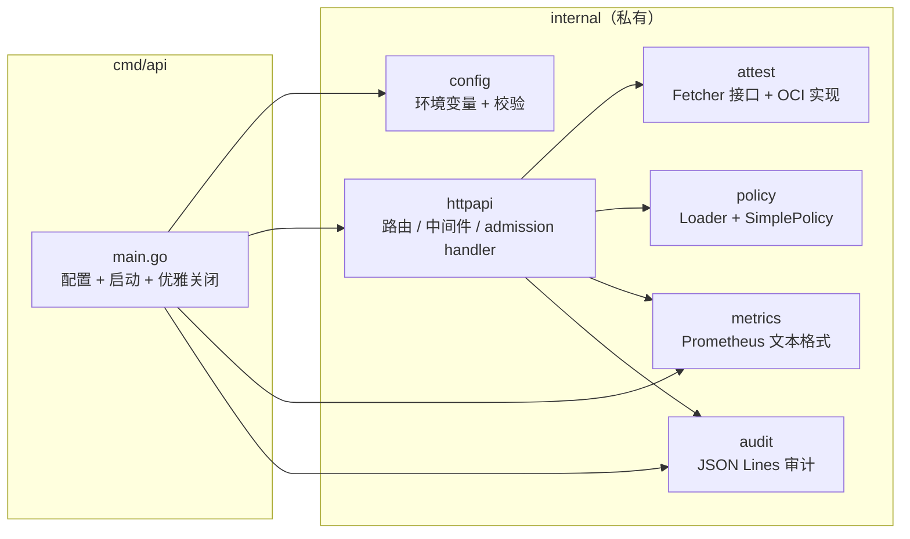

# attest

**在 Kubernetes 准入阶段强制执行 SLSA provenance。默认 fail closed。**

> **状态：阶段四完成（可观测性已接入）**
>
> 已完成：
> - 阶段一：HTTP 骨架、AdmissionReview 解析、TLS、Kind 端到端。
> - 阶段二：真实 OCI Referrers API、SLSA provenance 解析、策略引擎、网络受限下的 fail closed 验证。
> - 阶段三：策略文件化（YAML Loader），改策略不改代码。
> - 阶段四：核心路径测试覆盖、Prometheus 指标、结构化审计日志。
>
> 剩余：阶段五（Helm chart、cert-manager、PDB、HPA、NetworkPolicy、RBAC）。

## 为什么做这个

软件供应链工具链已经解决了**生成证明**的问题：Sigstore 签名，in-toto 定义格式，SLSA 定义等级。缺的是在**部署时强制执行**它。

现有准入策略引擎擅长签名校验和静态字段匹配，但缺少原生方式来验证**语义化断言**：这个镜像是否达到 SLSA Level 3？构建者是否在可信白名单内？

另外，`ValidatingWebhookConfiguration.failurePolicy` 默认是 `Ignore`——Webhook 挂掉时请求直接放行。任何依赖这个默认值的策略，在故障瞬间等于不存在。

attest 填补的正是这个缺口：一个聚焦、可审计、默认 fail closed 的 Kubernetes 准入语义化证明验证器。

## 不可协商的标准

1. 验证发生在 **Kubernetes 准入阶段**。
2. 证明缺失、拉取失败、签名无效、格式非法、策略不满足——**全部返回 deny**。
3. 验证的是**语义化断言**（SLSA 等级、构建者身份、源仓库）。
4. 策略以**声明式配置**表达。改策略不需要改代码。
5. `ValidatingWebhookConfiguration.failurePolicy` 必须为 **`Fail`**。

**第 5 条的权衡**：Webhook 不可用时，新 Pod 无法部署。这是有意的——安全策略失效时放行，等于没有策略。

## 架构

```mermaid
flowchart TB
    subgraph Dev["CI"]
        CI["CI Pipeline<br/>构建 + 签名 + 生成证明"]
        USER["kubectl"]
    end
    subgraph Registry["OCI Registry (v1.1 referrers)"]
        IMG["镜像"]
        ATT["证明<br/>in-toto / SLSA"]
    end
    subgraph K8s["Kubernetes"]
        API["kube-apiserver"]
        WHC["ValidatingWebhookConfiguration<br/>failurePolicy: Fail"]
    end
    subgraph Svc["attest-admission"]
        HTTP["HTTP :8443 (TLS)"]
        ADM["准入处理器"]
        FETCH["Fetcher<br/>(go-containerregistry)"]
        POL["Policy Engine<br/>(YAML Loader)"]
        MET["Metrics<br/>/metrics"]
        AUD["Audit<br/>JSON Lines"]
    end
    CI -->|推送| IMG
    CI -->|签名并附加| ATT
    USER -->|apply Pod| API
    API --> WHC -->|AdmissionReview| HTTP --> ADM
    ADM -->|repo@digest| FETCH
    FETCH -->|Referrers API| ATT
    FETCH -->|Provenance| POL
    ADM --> MET
    ADM --> AUD
    ADM -->|allow / deny| API
    API -->|deny| USER
```

### 包结构



关键约束：依赖单向；`policy` 不依赖 `attest`；所有依赖通过 `*Deps` 显式注入，无全局可变状态。

## 快速开始

**前置要求**：Go 1.26+、Docker、kind、kubectl。

### 本地运行

```bash
git clone git@github.com:wyh-code26/attest.git
cd attest

./hack/gen-certs.sh
make run

# 验证
curl --cacert certs/ca.crt -s https://localhost:8090/healthz
curl --cacert certs/ca.crt -s https://localhost:8090/metrics
```

### Kind 集群部署

```bash
docker build -t attest-api:latest .
kind create cluster
kind load docker-image attest-api:latest

kubectl apply -f deploy/deployment.yaml
kubectl apply -f deploy/service.yaml
kubectl apply -f deploy/webhook.yaml
```

### 验证拦截

```bash
# 未固定 digest 的镜像 → 拒绝
kubectl run test-rejected --image=nginx:alpine

# 带 digest 但无证明的镜像 → 拒绝
kubectl run test-no-proof --image=nginx@sha256:1111111111111111111111111111111111111111111111111111111111111111

# 查看审计日志
kubectl logs -l app=attest-admission --tail=20
```

## 策略配置

`policy.yaml` 控制准入规则。修改后重启服务生效，不需要重新编译二进制。

```yaml
min_slsa: 3
allowed_builders:
  - "https://github.com/actions/runner"
allowed_types:
  - "https://slsa.dev/provenance/v1"
```

## 可观测性

### Prometheus 指标

`GET /metrics` 暴露以下计数：

```text
attest_admission_requests_total{result="allow"}
attest_admission_requests_total{result="deny_no_object"}
attest_admission_requests_total{result="deny_invalid_image"}
attest_admission_requests_total{result="deny_missing_attestation"}
attest_admission_requests_total{result="deny_fetch_error"}
attest_admission_requests_total{result="deny_policy"}
attest_admission_requests_total{result="error_bad_request"}
attest_admission_requests_total{result="error_method_not_allowed"}
attest_admission_requests_total{result="error_internal"}
```

### 审计日志

每次决策写一行 JSON 到 stdout：

```json
{"time":"...","request_id":"...","uid":"...","kind":"Pod","namespace":"default","name":"test","operation":"CREATE","image":"nginx:alpine","allowed":false,"reason":"deny_invalid_image","message":"..."}
```

`reason` 与 metrics 的 `result` 对齐，可用 `request_id` 与应用日志串联。

## 测试覆盖率

| 包 | 覆盖率 |
|---|---|
| `internal/audit` | 100% |
| `internal/config` | 100% |
| `internal/metrics` | 100% |
| `internal/policy` | 90.9% |
| `internal/httpapi` | 81.4% |
| `internal/attest` | 72.3% |

`cmd/api` 依赖真实网络和 TLS 启动，由 Kind 集成测试覆盖。

## 设计决策

### 依赖主权

- **引入 `go-containerregistry`**：OCI 协议手写成本过高，但被严格封装在 `internal/attest/oci_fetcher.go`。模块总数从 1 增至 48。
- **拒绝 `in-toto/attestation`**：只需读取 SLSA provenance 的少数几个字段，手写 20 行 struct 比引入 protobuf 依赖树更划算。
- **拒绝 `prometheus/client_golang`**：只需要一个 counter，手写 Prometheus 文本格式的成本远低于引入新依赖树。

### 运行时行为

- **`Fetcher` 接口接收完整 image 引用**（`repo@sha256:...`），不是单纯的 `digest`。只有 digest 无法定位 Registry 和 Repository。
- **业务拒绝返回 HTTP 200 + `allowed: false`**，协议错误才返回 4xx。
- **缓存只存已验证的证明**，不存原始字节。接口包含 `Invalidate(digest)` 和可配置 TTL。
- **TLS 证书启动时加载**，更新证书需重启 Pod。热加载推迟到阶段五集成 cert-manager 时实现。

### 环境与安全

- **Kind 集群内网络受限**：容器无法直接访问公网 `docker.io` Registry API（实测 `connection refused`）。这不影响 fail closed 语义：拉取失败时请求被正确拒绝。
- **Webhook 自举问题**：`objectSelector` 排除 `app=attest-admission` 标签，防止 Webhook 拦截自身 Pod 的创建。
- **`failurePolicy: Fail` 是核心承诺**：Webhook 不可用时，新 Pod 无法部署。代价是 Webhook 必须高可用。

## 路线图

| 阶段 | 范围 | 状态 |
|---|---|---|
| 1 | 骨架、TLS、Kind 端到端 | 已完成 |
| 2 | 真实 OCI 拉取、策略引擎、fail closed 验证 | 已完成 |
| 3 | 策略文件化（YAML Loader） | 已完成 |
| 4 | 测试覆盖、指标、审计日志 | 已完成 |
| 5 | Helm chart、cert-manager、PDB、HPA、NetworkPolicy、RBAC | 计划中 |

## 开发

```bash
make ci      # gofmt + go vet + go test -race
make build   # 编译到 bin/attest-api
make run     # 编译并运行
make test    # 仅跑测试
```

CI（GitHub Actions）在每次 push 与 PR 时运行 `gofmt`、`go vet`、`go test -race`。

## 许可证

[](LICENSE)

本项目采用 [MIT License](LICENSE) 开源协议。
